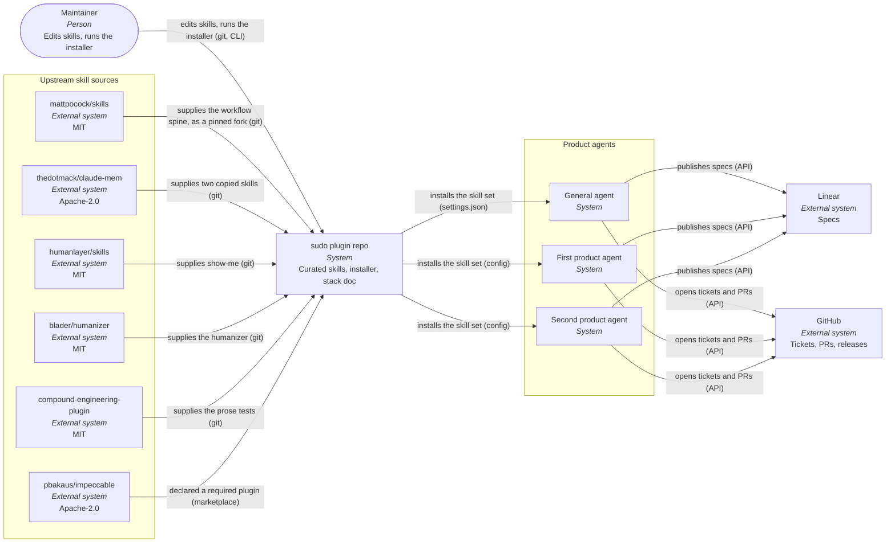
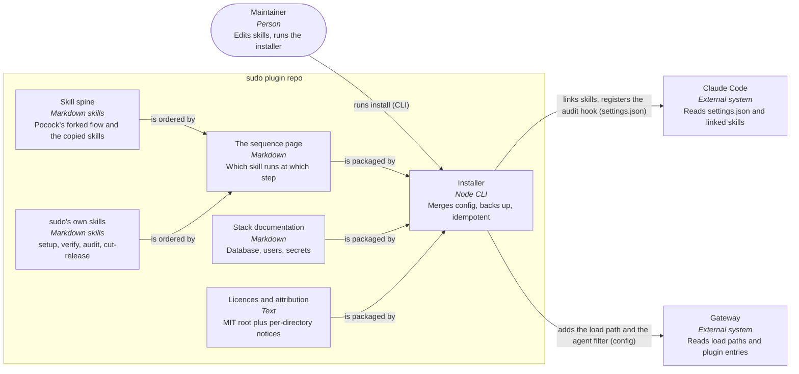

# sudo — one curated skill workflow for product work - Plan

## Goal Capsule

- **Objective:** every product session in every agent runs the same named sequence of skills, and a separate agent audits each change against evidence before it is marked done.
- **Means:** one public plugin repo installed into each agent by its own installer, carrying a curated skill set and a fixed stack.
- **Product authority:** the maintainer. Scope is the plugin and its install path. The individual product repos that consume it are out of scope, apart from the disposition of the skills they already carry (R15).
- **Open blockers:** the curated-spine half of the work (R1–R5, R7, R18) is blocked on OQ3 and OQ6. The installer and single-source half (R6, R10–R14, R16, R17) is unblocked and ready to plan.

---

## Product Contract

### Summary

sudo is a public Claude Code plugin holding the whole product workflow: a curated skill set built on a pinned fork of Matt Pocock's skills, two skills from claude-mem, one from HumanLayer, two prose skills, a reference to Impeccable for design, and five skills of its own. It fixes the issue-tracker split (specs in Linear, tickets in GitHub) and documents the stack. One installer puts the same set into all agents, and edits happen only in this repo.

### Problem Frame

No two agents load the same skills, and nothing names the order they run in.

One product repo carries four skills of its own under `.claude/skills/`, plus Impeccable and a legal plugin installed at project scope, and five hooks registered in `.claude/settings.json`. Another agent workspace carries Superpowers and Compound Engineering at user scope. One public fork holds generic skills, untouched for months. A private repo holds one skill alongside UX artifacts and documentation.

The cost lands in two places. A session picks whichever skill it happens to reach for, so the same kind of change gets a different process depending on which agent and which repo it started in. And because every agent has its own copy, fixing the process means editing it in three places or letting it drift.

### Key Decisions

- **The spine is Matt Pocock's skills, not a new flow.** His set is MIT, actively released, and already shaped around the grill-spec-tickets order sudo needs. Writing a competing flow would mean maintaining it. His setup skill configures a single tracker per repo, so the Linear/GitHub split needs edits inside `to-spec` and `to-tickets` themselves. Governs R1, R2, R3.
- **Pocock's skills come in as a pinned fork, not a one-off copy.** sudo forks `mattpocock/skills`, pins the fork at a named commit, and carries the tracker-split edits as commits on top. A static copy would strand sudo on whatever shape his set had the day it was taken; a fork keeps a merge path open for every release he cuts. Governs R1.
- **Compound Engineering is out of product work.** The sequence runs on Pocock's flow plus sudo's own and copied skills. Two process flows in one session is the problem sudo exists to end, and the Compound Engineering skills duplicate the grill-spec-tickets spine step for step. It keeps whatever non-product use it already has; nothing in the sequence calls it. Governs R6, R7.
- **Specs live in Linear, tickets live in GitHub.** One tracker for the shape of the work, one for the units of it. Governs R3.
- **sudo is the only process-skill source for the product agents.** An agent that can reach two competing process skills follows whichever one the session happens to pick first. Governs R6, R7, R14.
- **A separate agent audits before anything is marked done, enforced by a hook.** A build agent scoring its own work accepts its own reading of the acceptance criteria, and a gate a session can decline gets declined under time pressure. One product repo already blocks completion this way through a hook. Governs R8, R9, R10.
- **The installer is modelled on `agent-problem-solving`.** `bin/aps.mjs install` already merges rather than replaces, backs up every file it touches, does nothing on a second run, detects which runtimes are present when given no argument, and supports `--dry-run`. That behaviour already runs against a live gateway config, so copying the shape is cheaper than specifying it again. Governs R11, R12, R13.
- **Two lanes, and the maintainer picks which one.** A change either takes the spec path or the short one, and there is no triage agent in between. The maintainer names the lane; if not, the agent states in one line which lane it is taking and continues, which the maintainer can overrule. Both lanes run the same inner loop, and a review by an agent that took no part in the build is required in both. Governs R6, R8, R19.
- **Impeccable is referenced, not copied.** It is on version 4.5.2 and still shipping; a vendored copy freezes it at 4.5.2 and adds Apache-2.0 attribution work for a skill sudo does not need to edit. Governs R5, R16.
- **sudo is MIT, with per-directory licences for anything vendored.** Matches `agent-problem-solving` and `secretdrop`, both MIT. Governs R16.
- **The repo is public.** Public provenance lets users audit the workflow and reuse it. Per-directory licences and notices keep each third-party source and its terms visible. Governs R16.

### Actors

- A1. **The maintainer** — edits the skills, runs the installer, approves a release.
- A2. **The general agent** — runs product work alongside non-product work out of one workspace.
- A3. **The first product agent** — owns one product's work.
- A4. **The second product agent** — owns another product's work.
- A5. **The audit agent** — a fresh subagent with no part in the build, checking a change against its acceptance criteria and reporting evidence.

### System context

Upstream skill sources feed the repo; the repo feeds the three agents; each agent writes to both trackers.

### Containers

Inside the repo, the installer carries each part into the two runtimes.

### Requirements

**The skill set**

- R1. sudo carries Matt Pocock's skills as its workflow spine: `grill-with-docs`, `to-spec`, `to-tickets`, `implement-spec`, `tdd`, `code-review` and `pr`. They arrive as a fork of `mattpocock/skills` pinned at a named commit, carrying sudo's tracker-split edits as commits on top. An upstream release can be merged in rather than re-copied. Every forked skill is exposed under sudo's name, and sudo owns its implementation. Changing one is an ordinary commit in this repo, recorded in that skill's `UPSTREAM.md`.
- R20. One command pulls upstream changes into the fork. It fetches `mattpocock/skills`, lists the skills that changed and the ones that are new since the pinned commit, and merges them on a branch. A fresh agent then reviews the result: what changed in behaviour, where an upstream change collides with a sudo edit, and whether a new skill belongs on the sequence page. That review goes into a PR for the maintainer, and the pin moves only when the maintainer merges it.
- R2. sudo copies two skills from `thedotmack/claude-mem`: `design-is` (the Dieter Rams design review) and `pathfinder` (feature-grouped architecture mapping). Each copy keeps the Apache-2.0 licence text, the copyright notice and a record of what sudo changed, in the directory holding it.
- R3. sudo exposes a per-repo setup skill as `/sudo:setup`, which asks for the Linear team and the GitHub repo, confirms the stack, and writes the repo's configuration so that `/to-spec` publishes to Linear and `/to-tickets` opens GitHub issues without a session having to be told the split.
- R4. sudo carries five skills of its own: two for framing and capturing learnings, `/verify` for UI verification, `/audit` for the acceptance-criteria check, and `/cut-release` for releases.
- R5. sudo declares Impeccable as a required plugin for UI design work and names it in the sequence, rather than carrying a copy of it.
- R18. sudo carries HumanLayer's `show-me`, either forked or copied with its MIT notice kept, and the sequence calls it so a change is explained as a diagram, a call tree or a component sketch before the PR opens.
- R21. sudo copies two prose skills: `humanizer` and `ce-noslop`, both MIT and both unchanged. Every piece of prose a session publishes for a person to read passes through both of them first. The humanizer removes AI writing patterns, then the prose tests check for clarity. This covers a spec, a ticket, a PR body and anything written into a repo's documentation. It does not cover a message in a chat window, and it never rewrites a quotation, a command or an identifier.

**The sequence and the audit gate**

- R6. One page in the repo states which skill runs at each step of product work and in what order, which steps belong to the quick lane and which to the full one, which of them make up the inner loop, and the branch conditions that let a step be skipped. That page is in a product session's context from the start without the session being told to read it.
- R7. A product agent loads sudo's skills and the plugins sudo itself declares as required, and no competing process or workflow skill plugin alongside them. The runtime's own built-in skills are outside this rule.
- R8. Each ticket ends with an audit by an agent that took no part in the build, checking the change against the acceptance criteria written into that ticket, and a completion hook the installer registers blocks the ticket being marked done until an audit report exists.
- R9. The audit report names each skill that ran, names each conditional step that was skipped together with its reason, and attaches proof for each acceptance criterion: a test run, a screenshot, a query result or a diff.
- R19. Product work runs in one of two lanes. The maintainer names the lane; when no lane is named, the session states in one line which lane it is taking before it starts. The lane and the reason go into the run record. The quick lane is the inner loop with the ask and its done-when restated in front of it, and it ends in a PR. The full lane is the spec path, running the inner loop once per ticket, then a review of the whole branch. Neither lane can reach its PR without a review by an agent that took no part in the build.
- R10. Each step of the sequence appends an entry to a per-change run record, giving the step, the skill, the outcome, and the reason where it was skipped. The audit agent derives its report from that record rather than from its own reconstruction.

**Installing and propagating**

- R11. One command with no arguments installs sudo into every runtime it detects, covering both Claude Code and the OpenClaw gateway in a single run.
- R12. The installer backs up any file it changes, changes only the keys sudo owns, leaves the rest byte-identical, and reports without writing under `--dry-run`.
- R13. A second run of the installer changes nothing and says so.
- R14. sudo's skills are edited only in the sudo repo. An agent's workspace holds a pointer to the installed plugin and no copy of a sudo skill, and the installer records which sudo release it installed in each runtime.

**Existing repo-local skills**

- R15. Each of the product repo's four local skills is either absorbed into sudo or explicitly kept, with the reason stated.

**Licensing**

- R16. The repo carries MIT at its root, and any directory holding vendored third-party work carries that work's own licence text, its copyright notice, and a note of what was changed.

**The stack**

- R17. One page states the fixed stack (Neon for the database, Clerk for users, secretdrop for handing secrets to a machine) and the budget rules that make it the default.

### Key flows

- F1. **A product change on the full lane**
  - **Trigger:** the maintainer asks an agent for a change in a product repo and names the full lane, or the agent says it is taking that lane.
  - **Actors:** A1, and one of A2–A4, then A5.
  - **Steps:** The agent names the problem, grills the maintainer on it, writes the spec to Linear and breaks it into GitHub tickets. Per ticket it runs the inner loop: build it test-first, run the design and verification passes if it touched UI, get a review from an agent that did not build it, fix what that review found, and pass the audit. Once the last ticket is through, the whole branch gets one more review, the change is drawn with `/show-me`, and the PR opens.
  - **Outcome:** one audited PR, its body carrying the audit report naming every skill that ran, the proof for each acceptance criterion, and a `/show-me` view of what changed.
  - **Covered by:** R1, R3, R6, R8, R9, R10, R18, R19

- F2. **A change to the process itself**
  - **Trigger:** the maintainer wants a skill changed, added or removed.
  - **Actors:** A1
  - **Steps:** the maintainer edits the skill in the sudo repo, cuts a release, then runs the installer once.
  - **Outcome:** all agents run the changed process, each recording the release it installed; no agent workspace was edited.
  - **Covered by:** R11, R13, R14

- F3. **A fresh repo**
  - **Trigger:** a product repo has sudo available but has never used it.
  - **Actors:** A1, and one of A2–A4.
  - **Steps:** `/sudo:setup` asks for the Linear team and the GitHub repo, confirms the stack, and writes the repo's configuration.
  - **Outcome:** the tracker split is live in that repo without a session having to be told it.
  - **Covered by:** R3, R17

- F4. **A product change on the quick lane**
  - **Trigger:** the maintainer asks for a change whose shape is already clear and names the quick lane, or the agent says it is taking that lane.
  - **Actors:** A1, and one of A2–A4, then A5.
  - **Steps:** The agent restates the ask and its done-when in a line or two, then runs the inner loop once: build it test-first, verify what a user sees if it touched UI, get a review from an agent that did not build it, fix what that review found, pass the audit, and open the PR. No Linear spec, no tickets.
  - **Outcome:** one PR, reviewed by an agent that took no part in the build, with the lane and the restated done-when in the run record.
  - **Covered by:** R6, R8, R9, R10, R19

### The sequence

Product work runs in one of two lanes, and the maintainer picks which. If not, the agent states in one line which lane it is taking and continues, which the maintainer can overrule in their next message. There is no triage agent in between.

Both lanes run the same inner loop. The loop assumes its input is already well defined, so it executes from the instructions rather than going back to scope the work: build test-first, verify what a user sees where the change touches the UI, hand the work to an agent that took no part in building it, fix what that agent finds, and only then mark it done. The outside review is required in both lanes.

The **quick lane** is that loop with one step in front of it. The agent restates the ask and its done-when in a line or two. That restatement is what makes the input well defined enough to execute from. The lane ends in a PR.

The **full lane** is the spec path: spec into Linear, tickets into GitHub, then implement, running the inner loop once per ticket. After the last ticket comes a review of the whole branch, which catches how the tickets sit together rather than how each one was built. `implement-spec` already does this at its step 7, but with Pocock's `code-review` alone, which checks the code against the repo's standards and the spec. sudo runs a second reviewer next to it: Anthropic's `engineering:code-review`, which looks for security, performance and correctness problems. Each runs as a fresh agent, the two run in parallel, and one implementer fixes what both found. Inside the inner loop each ticket gets Pocock's `code-review` only. Then the change gets drawn, then the PR opens.

Anything a person will read is written twice over. The step that writes it drafts it, then `humanizer` strips the AI tells and `ce-noslop` checks each sentence against its own tests, and only then is it published. Specs, tickets and PR bodies all take that pass, and so does anything written into a repo's documentation.

Steps marked conditional are skipped when the condition does not hold, and the skip is named in the run record and the audit report. Nothing here calls a Compound Engineering skill other than `ce-noslop`, which sudo carries as a copy rather than calling the plugin.

| # | Step | Skill | Lane | Condition |
|---|---|---|---|---|
| 1 | Configure the repo | `/sudo:setup` | Both | Once per repo |
| 2 | Restate the ask and the done-when | In the session, one or two lines | Quick | Always |
| 3 | Name the problem | `frame-problem` / `focus` | Full | Always |
| 4 | Map the architecture | `/pathfinder` | Full | Work spans features that already duplicate each other |
| 5 | Align and build the glossary | `/grill-with-docs` | Full | Always |
| 6 | Write the spec | `/to-spec` → Linear, then the two prose skills on what it wrote | Full | Always |
| 7 | Break into tickets | `/to-tickets` → GitHub, then the two prose skills on what it wrote | Full | Always |
| 8 | Build it test-first ★ | `/tdd` | Both | Always; the full lane runs it per ticket under `/implement-spec` |
| 9 | Design and verify what a user sees ★ | `/impeccable`, `/design-is`, then `/verify` | Both | The change touches UI |
| 10 | Review the work ★ | `/code-review`, in an agent that did not build it | Both | Always |
| 11 | Fix what the review found ★ | `/tdd` | Both | The review found something |
| 12 | Audit against acceptance criteria ★ | `/audit`, in a fresh agent | Both | Always |
| 13 | Review the whole branch | `/code-review` and `engineering:code-review` in parallel, each a fresh agent, on the integration branch | Full | Always |
| 14 | Show the change, then open the PR | `/show-me`, then `/pr`, with the PR body through the two prose skills | Both | Always |
| 15 | Release, then capture what was learned | `/cut-release`, then `cairn:interview` | Both | The change ships; the capture only where it produced a decision worth keeping |

★ marks the inner loop. Steps 8 to 12 are the whole of the quick lane after step 2, and one pass of them is what the full lane does per ticket.

```mermaid
flowchart LR
  ask(["Maintainer asks for a change"])
  lane{"1. Which lane?"}
  q["2. Restate the ask<br/>and its done-when"]
  spec["3. Write the spec,<br/>then cut the tickets"]
  subgraph loop["The inner loop"]
    direction LR
    build["4. Build it test-first"]
    ver["5. Verify what a user sees"]
    rev["6. Review it in another agent"]
    fix["7. Fix what the review found"]
  end
  branch["8. Review the whole branch"]
  pr["9. Show it, then open the PR"]

  ask -->|"names the change"| lane
  lane -->|"quick"| q
  lane -->|"full"| spec
  q -->|"hands over a defined ask"| build
  spec -->|"hands over one ticket"| build
  build -->|"working change"| ver
  ver -->|"evidence"| rev
  rev -->|"findings"| fix
  fix -->|"quick lane"| pr
  fix -->|"full lane, last ticket done"| branch
  branch -->|"findings fixed"| pr
```

1. The maintainer says which lane the change takes. If not, the agent says which one it is taking in one line, which the maintainer can overrule.
2. On the quick lane the agent says back what it is building and what would count as finished, so the loop has something definite to work from.
3. On the full lane the change is argued out, written up as a spec, and cut into tickets first. The loop then runs once per ticket.
4. The agent builds it test-first, from whatever the lane handed over.
5. Where a user can see the change, the agent drives the running app and captures what it looks like.
6. A different agent, one that had no part in building it, reviews the work. This happens on both lanes and cannot be dropped from either.
7. Whatever the review found gets fixed before the work is called done.
8. On the full lane only, once every ticket is through the loop, the whole branch gets one more review. Separate tickets can each be right and still fit together badly.
9. The change is drawn so it can be read at a glance, and the PR opens.

### Acceptance examples

- AE1. **Covers R7.** Given a session opened by a product agent with sudo installed, when the session lists its available skills, then sudo's skills and the plugins sudo declares as required appear, and no other process or workflow skill plugin does.
- AE2. **Covers R8, R9.** Given a ticket whose build agent reports it complete, when the audit agent runs, then its report names every skill that ran in order and attaches one piece of proof per acceptance criterion; a criterion with no proof fails the audit and the completion hook keeps the ticket open.
- AE3. **Covers R13.** Given sudo already installed, when the installer runs again with no arguments, then it writes nothing and reports that each runtime is already installed.
- AE4. **Covers R12.** Given an `openclaw.json` holding plugin entries sudo does not own, when the installer runs, then those entries are byte-identical afterwards and the file has a dated backup beside it.
- AE5. **Covers R9, R10.** Given a ticket that touched no UI, when the audit agent runs, then the report names step 9 as skipped and gives the reason from the run record, rather than omitting it.
- AE6. **Covers R14.** Given a skill edited in the sudo repo and released, when the installer runs, then all three agents load the edited skill, each reports the same installed release, and no file under an agent's workspace changed.
- AE7. **Covers R19.** Given a change the maintainer asked for without naming a lane, when the session starts, it states in one line which lane it is taking before doing any work, and the run record holds that lane. Given a quick-lane change whose build agent reports it complete, when no review by another agent exists, the PR step is blocked the same way a full-lane ticket's would be.

### Success criteria

- A change made in one agent and a change made in another, of the same kind and on the same lane, name the same skills in the same order in their audit reports.
- A process fix is made once, and all three runtimes report the same installed release afterwards.
- The sequence page reaches a session without the maintainer having to name it.
- The sequence does not lengthen the time from the maintainer's request to a merged PR for a change of the same kind.

### Scope boundaries

**Deferred for later**

- A marketplace listing or any public install path for people outside the organisation.
- Codex, Gemini and Copilot as install targets. Claude Code and OpenClaw first.
- Automated drift checks that compare what a session actually ran against the sequence page.
- Moving `weekly-sync` or the `gws` cheatsheet out of `sudo-workflows`.

**Outside this plugin's identity**

- Replacing Pocock's skills with a flow of sudo's own. sudo curates his set and adds to it.
- Non-product work. Each agent's own non-product skills stay where they are, and R14 does not reach them. Compound Engineering sits here now: sudo neither carries it nor calls it, and whatever use it has outside product work is untouched.
- Owning the product repos' own CI, deploy or infrastructure configuration.

### What happens to the existing repos

- **The public fork of generic skills — replace, then archive.** It is a fork of `addyosmani/agent-skills` (MIT), holding generic engineering skills that overlap the spine. Nothing in sudo comes from it. Archiving it removes a second public skill repo that a reader would mistake for the real one.
- **The private workflows repo — sits next to sudo.** It is private and mostly artifacts: UX reviews, screenshots, a workspace cheatsheet, and one skill for team operations rather than product engineering. Those artifacts cannot go public, and that skill is out of sudo's scope. Leave it where it is.
- **The product repo's `.claude/skills/` — per-skill disposition under R15.** Two have counterparts in the spine and in `/verify`. Two have none, so absorbing them would widen sudo's scope and keeping them means that agent still loads a skill from outside it.
- **agent-problem-solving — unresolved (OQ9).** It is already an enabled plugin for all agents, so R4 would put a second copy of its skills in front of the same agents.

### Dependencies and assumptions

- D1. **Assumption:** `mattpocock/skills` stays MIT and keeps shipping. sudo forks it from the start, so a relicence or an abandonment costs nothing beyond the merges stopping. An upstream rename or restructure changes sudo's documented process, which is a wider blast radius than a version bump, and the fork makes that a merge conflict the maintainer sees rather than a silent drift.
- D7. **Assumption:** `humanlayer/skills` stays MIT. It is an active repo, MIT at the root, and `show-me` is one plugin inside it rather than the whole repo, so a fork or a copy of that one directory is enough.
- D2. **Decision:** the sudo repo is public, with the hygiene and attribution checks in R16 applied before its first push.
- D3. **Dependency:** Linear API access for `/to-spec`. The key is already present as an environment variable.
- D4. **Dependency:** an installed Impeccable. It is a project-scoped install in one product repo, so the other agents' sessions have no design skill at that step until R5's declaration is honored by whichever runtime loads sudo.
- D5. **Assumption:** the framing and learning-capture skills can be extracted from their current home. They live in a plugin directory with no git repository.
- D6. **Dependency:** browser access for the screenshots R9 requires. Playwright is granted in one product repo's settings only.

### Outstanding questions

Resolved and now in Key Decisions: whether sudo vendors or forks Pocock's skills (a pinned fork), what Compound Engineering does in a product session (nothing), and where the floor is below which a change skips the spine (two lanes, the maintainer picks, and the outside review holds in both).

**Resolve before planning**

- OQ3. **Where does the framing and learning source live?** It is a plugin directory with no git history. Either its skills move into sudo and that copy is retired, or it gets its own public repo that sudo depends on, or the copy stays and sudo only references it, which breaks R14.
- OQ6. **Can either runtime actually exclude a competing skill plugin?** Superpowers and Compound Engineering are installed at user scope in Claude Code, which a project-scoped install does not unload, and the gateway allowlist is per agent. Dropping Compound Engineering from the sequence settles which flow a session should follow but not which skills it can still reach. If neither runtime can exclude, R7 and AE1 are restated as one authoritative sequence rather than one loaded plugin.
- OQ9. **Does sudo vendor agent-problem-solving's skills or depend on it?** It is already an enabled plugin for all agents. Vendoring means retiring the standalone plugin; depending means R4 names it as a required plugin instead of a carried skill.
**Deferred to planning**

- OQ4. How fixed is the stack? R17 documents the default. Whether a skill refuses an alternative, warns about one, or merely documents the default is an implementation choice.
- OQ5. Whether `/audit` is its own skill or a mandatory final phase inside `/verify` and `/cut-release`. The maintainer named four own skills; the audit requirement adds a fifth, and it may belong inside the two that already produce evidence.
- OQ7. What marks a session as a product session. R7 is written per agent, which covers the two product agents cleanly but not the general agent, which runs product and non-product work from one workspace. The boundary may be the repo, the agent, or a mode a session enters.
- OQ11. Which of the product repo's four local skills are absorbed and which are kept (R15). Two have no counterpart in R1–R5.
- OQ12. Settled: sudo edits its fork of `implement-spec` so each implementer subagent runs the full inner loop, and the whole-branch review calls both reviewers. These are ordinary sudo commits recorded in the skill's `UPSTREAM.md` (R1), and R20 brings upstream changes in on top of them.
- OQ13. Where does the additional code-review skill come from? It ships in a separate plugin, which has to be installed separately. Its licence and source need checking before sudo either carries a copy or names the plugin as a dependency. The change to `implement-spec`'s review step itself is settled under OQ12.

### Sources

- `mattpocock/skills` (MIT) — the spine. The core flow: `grill-with-docs` → `to-spec` → `to-tickets` → `implement-spec` → `code-review` → `pr`, with a setup skill run once per repo. That setup skill writes `docs/agents/issue-tracker.md`, which both `to-spec` and `to-tickets` read; Linear exists there only as the freeform "Other" option.
- `thedotmack/claude-mem` (Apache-2.0) — two copied skills. `design-is` scores a UI against Rams' ten principles with cited evidence and returns a NEW/REFINE/REDESIGN verdict. `pathfinder` maps features into flowcharts and reports duplicated concerns.
- `humanlayer/skills` (MIT) — HumanLayer's `show-me`. The skill picks the smallest view that makes the point: pseudocode for logic, a call tree for control flow, a component tree for UI, a shallow file tree for a refactor, or a focused HTML artifact. Its frontmatter sets `disable-model-invocation: true`, so it only runs when a step calls it, which is why R18 names it in the sequence rather than leaving it to a session.
- `blader/humanizer` (MIT) — a catalogue of the patterns that give AI writing away, with the fix for each. The repo holds the one skill plus packaging; nothing else is needed.
- `compound-engineering-plugin` (MIT), `skills/ce-noslop` — a set of tests a sentence has to pass (does it say what the thing does, does it name the actor, is it one idea, can a reader act on it) plus a pattern catalogue. It points at a sibling skill, `ce-promote`, which sudo does not carry.
- `pbakaus/impeccable` (Apache-2.0), version 4.5.2 — one skill with 24 commands for design work.
- The public fork of generic skills — fork of `addyosmani/agent-skills`, MIT.
- The private workflows repo — one skill plus UX artifacts.
- agent-problem-solving (MIT) — the installer model. One function merges a hook into `settings.json` and links skills; another adds one load path and one plugin entry, merging rather than replacing so a re-run cannot drop an agent filter or re-enable a disabled entry. Neither touches another plugin's entry.
- secretdrop (MIT) — a one-time link that writes a secret to a named file at mode 0600 without the value passing through a chat window.
- The product repo's `.claude/settings.json` and `.claude/skills/` — four local skills, two project-scoped plugin installs, and five hooks including one that blocks completion until another agent has reviewed.

### Licence verdicts

Nothing in the set is copyleft, so there is no vendor-versus-reference decision forced by a licence. The choice is a maintenance one.

- **`mattpocock/skills` — MIT.** Copy, edit, rename and redistribute inside a public MIT repo. The only obligation is to keep the copyright notice and the licence text with the copied files, which a fork carries by default.
- **`thedotmack/claude-mem` — Apache-2.0.** Copying `design-is` and `pathfinder` is permitted. Three obligations come with it: keep the licence text and any NOTICE file, keep the attribution notices, and mark the files as changed where they were changed. Apache-2.0 is compatible with distributing inside an MIT-licensed repo as long as those files keep their own notice.
- **`pbakaus/impeccable` — Apache-2.0.** Same obligations if copied. Referencing it as a required plugin creates no obligation at all, which is the reason R5 references rather than copies.
- **`humanlayer/skills` — MIT.** Forking or copying `show-me` is permitted either way. The only obligation is to keep the copyright notice and the licence text with the files, the same as Pocock's.
- **`blader/humanizer` — MIT.** Copying is permitted, keeping the copyright notice and the licence text with the file.
- **`EveryInc/compound-engineering-plugin` — MIT.** Same. Copying the one `ce-noslop` directory creates no obligation towards the rest of the plugin, which sudo neither carries nor calls.
- **The generic-skills fork — MIT**, and a fork of an MIT upstream. Nothing blocks reuse; the reason not to reuse it is that its content duplicates the spine.
- **sudo itself — MIT**, matching `agent-problem-solving` and `secretdrop`. A single root MIT licence would misstate the vendored Apache-2.0 files, so R16 requires a per-directory licence for anything vendored.
