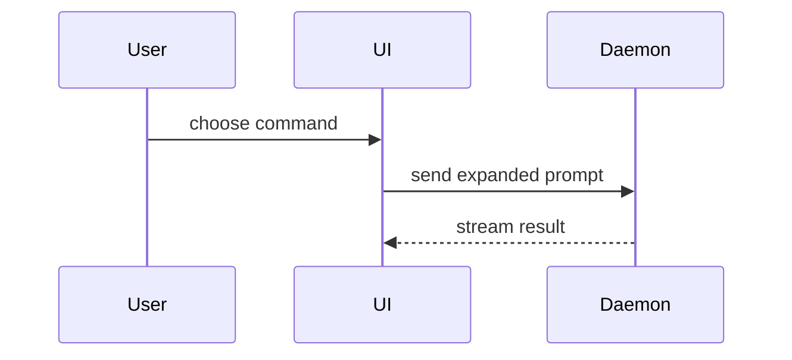

Help the user understand the current topic of conversation visually. Skip the preamble and keep prose brief. Pick the smallest view that makes the key point clear.

- Show logic or an algorithm as pseudocode:

```text
on(save)
  if content is unchanged
    return cached result
  write new content
  return fresh result
```

- Show runtime control flow as a call tree:

```text
submitForm
  createSession
    persistPrompt
    launchAgent
  navigateToSession
```

- Show UI structure as a component tree, including state and module boundaries that matter:

```tsx
<SessionPage> (apps/example/src/routes/session.tsx)
  useSessionEvents()
  <SessionToolbar>
    <RunSkillButton> (packages/ui)
```

- Show file responsibility or a broad refactor as a shallow file tree:

```text
src/
├── commands/       # parses user actions
├── sessions/       # owns session state
└── transport/      # sends API requests
```

- Show component interaction, control flow, or data flow with Mermaid:



- Use `diff` when the point is what changes and the surrounding shape already exists. Match the diff shape to the topic.

For a component change:

```diff
 <SessionPage>
   useSessionEvents()
   <SessionToolbar>
+    <RunSkillButton />
   <SessionTimeline>
+    <SkillResultCard />
```

For a file-layout change:

```diff
 src/
 ├── commands/
+│   └── show-me.ts       # expands the slash command
 ├── sessions/
-└── transport.ts
+└── transport/
+    ├── client.ts
+    └── stream.ts
```

For a call-tree or call-stack change:

```diff
 submitForm
   createSession
     persistPrompt
+    expandSkillMention
     launchAgent
-  navigateToSession
+  navigateToSession
+    subscribeToEvents
```

For a state or control-flow change:

```diff
 on(save)
-  write content
+  if content is unchanged
+    return cached result
+  write new content
+  invalidate cache
```

- Show the whole block when most of it is new, when omitted context would hide ownership or order, or when the user needs a copyable target shape:

```ts
function expandSkill(command: string): string {
  const skillName = command.slice(1)
  return `use the ${skillName} skill`
}
```

- For a visual UI, layout, state comparison, or concept too dense for Mermaid, make one focused HTML page — a diagram, an infographic, or a short slide deck, whichever fits the point. Match the product's colors, type, spacing, and components; use real labels and data; support desktop and mobile. Show it as "render it where the user is" says.

### render it where the user is

Pseudocode, call trees, component and file trees, diffs and code are plain text: put them in the reply, where every surface shows them as code blocks. Mermaid and HTML need something to draw them, and a terminal draws neither, so route those by the surface the session runs on. Check the surface once per session:

```sh
echo "entry=${CLAUDE_CODE_ENTRYPOINT:-} cmux=${CMUX_WORKSPACE_ID:+yes} ssh=${SSH_CONNECTION:+yes}"
```

Take the first row that matches:

| Surface | Signal | Show Mermaid and HTML by |
|---|---|---|
| Claude desktop app, claude.ai, or a remote shell | `entry=claude-desktop`, `entry=remote` or `ssh=yes` | Publishing the page with the Artifact tool and sharing its link. With no Artifact tool, the desktop app falls through to the last row; claude.ai and a remote shell put the Mermaid block in the reply and give the HTML file's path. |
| cmux | `entry=cli` and `cmux=yes` | Opening the page in a browser pane beside the session: `cmux browser open "file://<absolute path>" --focus false`. |
| IDE extension or any other terminal | anything else | Opening the page in the default browser: `open <path>` on macOS, `xdg-open <path>` on Linux, `start "" <path>` on Windows. |

Write the page to the session's scratchpad directory when it has one, otherwise to `${TMPDIR:-/tmp}`, named `show-me-<topic>.html`. A Mermaid diagram becomes a page by wrapping it in this template, with `&` and `<` in the diagram written as `&amp;` and `&lt;`:

```html
<!doctype html>
<html><head><meta charset="utf-8"><title>{topic}</title>
<style>:root{color-scheme:light dark}body{margin:24px;font:15px system-ui;background:Canvas;color:CanvasText}</style>
<script src="https://cdn.jsdelivr.net/npm/mermaid@11.4.1/dist/mermaid.min.js"></script></head>
<body><h1>{topic}</h1><p>{one line on what the diagram shows}</p>
<pre class="mermaid">
{diagram}
</pre>
<script>mermaid.initialize({startOnLoad:true,theme:matchMedia('(prefers-color-scheme: dark)').matches?'dark':'default'})</script>
</body></html>
```

In cmux, confirm the diagram drew before telling the user: `cmux browser --surface <ref from browser open> eval "document.querySelector('.mermaid svg') ? 'ok' : 'not rendered'"` prints `ok`. On `not rendered`, wait two seconds and run it once more; a second failure means the diagram has a syntax error to fix. Once a view opens outside the reply, the reply holds the short text and says where the view is (pane, link or path).

### guidance

Place each visual next to the short text it supports. Keep only the calls, files, props, states, and boundaries needed to answer the user's current question or the options to resolve the current discussion point.

You may use one of these, you may use several, it is unlikely you will use all of them. Use your judgement and don't overwhelm the user.
